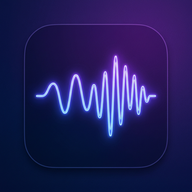

# Pitch Scaler (Android + iOS + macOS)

A D.R.Y. cross-platform **Kotlin Multiplatform + Compose Multiplatform** application for real-time audio pitch shifting across **Android**, **iOS** (including a **Safari Web Extension**), and **macOS Desktop**.



## D.R.Y. Shared Architecture
- **100% Shared UI & State (`composeApp/src/commonMain`)**: A single Compose Multiplatform codebase renders the dark neon dashboard, `SiriWaveform` visualizer, semitone controls (`-12` to `+12`), and mode selector natively on **Android, iOS, and macOS**.
- **Shared C++ SoundTouch DSP (`native/soundtouch`)**: Single source of truth for the native [SoundTouch](https://codeberg.org/soundtouch/soundtouch) C++ library with a platform-agnostic C API (`soundtouch_c_api.h`), shared by **both Android (NDK) and macOS (`libpitchscale_macos.dylib`)**.
- **Shared Web Audio Pitch Engine (`shared-web/`)**: Single WSOLA `AudioWorkletProcessor` (`pitch-worklet.js`) and media-element hook (`pitch-engine.js`) reused identically by both the **iOS In-App Browser Player** and the **iOS Safari Web Extension**.
- **Single Unified Build (`./build-all.sh`)**: Builds **all three apps** in one command.

## Platform Highlights

### macOS Desktop (macOS 14.2+) — Completely Seamless!
- Uses Apple's native **Core Audio Process Taps** (`CATapDescription` + `AudioHardwareCreateProcessTap`) with `CATapMutedWhenTapped` and a private hardware-synchronized **Aggregate Device**.
- Captures **all system audio** (Spotify, Apple Music, YouTube, Safari, Chrome, DAWs, etc.), automatically mutes the unshifted original audio at the hardware level, excludes Pitch Scaler's own PID, runs the shared C++ SoundTouch DSP in stereo, and outputs directly to your default MacBook speakers / AirPods / DAC with normal volume keys—**no virtual audio drivers (no BlackHole) required**.

### Android (API 29+)
- **Standard Mode (No Root):** Uses `AudioPlaybackCapture` (with `.excludeUid()` and dynamic native sample-rate detection for Android 16/17), native SoundTouch NDK, dynamic Headphone/Speaker routing, and `MediaSession` volume interception.
- **Optional Shizuku Mode (Seamless `Media` Stream):** When [Shizuku](https://shizuku.rikka.app/) is active via Wireless Debugging, registers a privileged `MIX_ROUTE_FLAG_LOOP_BACK` `AudioPolicy` to intercept other apps silently and output shifted audio directly on `USAGE_MEDIA` (`STREAM_MUSIC`).

### iOS (iOS 16+)
- **Built-in Browser Player (`WKWebView`):** Presets for **YouTube Music**, **YouTube**, and **SoundCloud** embedded inside the shared Compose UI, with `UIBackgroundModes: audio` for lock-screen/background playback over the normal Media stream.
- **Safari Web Extension (`PitchScaleSafariExtension`):** Pitch-shift YouTube, YouTube Music, SoundCloud, and HTML5 audio/video directly inside Mobile Safari (**Settings → Safari → Extensions → Pitch Scaler**).

## Building All 3 Apps
```bash
# Build Android APK + iOS Simulator App + macOS Desktop App
./build-all.sh

# Build Android APK + iOS Physical Device App + macOS Desktop App
./build-all.sh --device
```

Outputs:
- `dist/PitchScale-android.apk`
- `dist/PitchScale-ios.app.zip` (contains `PitchScale.app` + `PlugIns/PitchScaleSafariExtension.appex`)
- `dist/Pitch Scaler.app` (macOS Menu Bar + Dock app — run `open "dist/Pitch Scaler.app"`)
